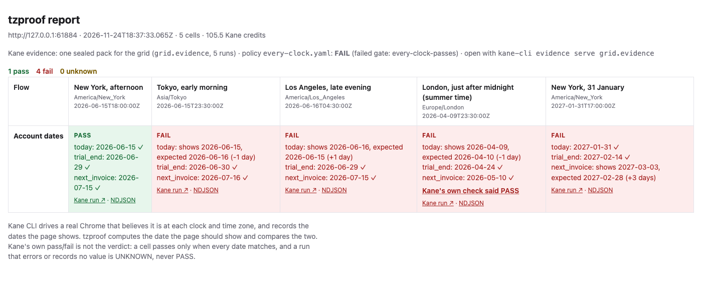
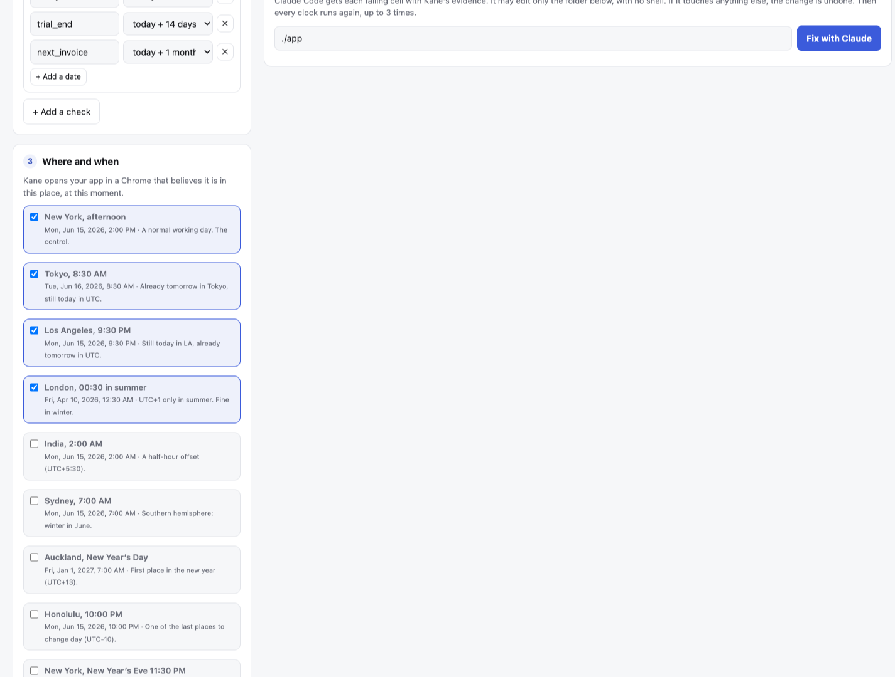
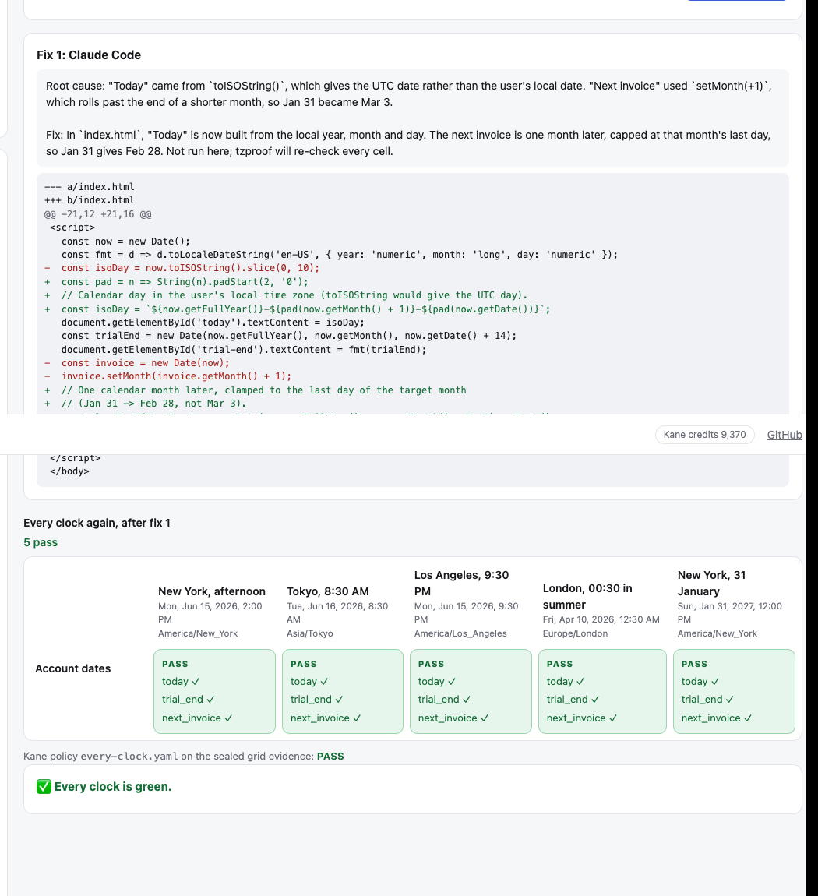

# tzproof

**Is your app right in every time zone, on every date?**

tzproof opens your app in a real Chrome that believes it is somewhere else, at some other moment (Tokyo at 8:30 AM, London just after midnight in summer time, 31 January, a leap day). [Kane CLI](https://github.com/LambdaTest/kane-cli) uses the app like a person and reads the dates it shows. tzproof works out what each date *should* be for that user and compares. When a date is wrong, your coding agent gets Kane's evidence and fixes the code, and the whole grid runs again until every cell is green.



## Why

Date bugs pass every test you run on your own laptop, at your own time of day. They show up for someone else:

- `new Date().toISOString().slice(0, 10)` is the UTC day. In Tokyo before 9 AM it is yesterday; in Los Angeles after 5 PM it is tomorrow.
- `date.setMonth(month + 1)` turns 31 January into 3 March.
- A date picker that returns local midnight, saved through `toISOString()`, stores the day before for anyone east of UTC. In London that only happens in summer.

Coding agents write this code all day, and their own checks run in one time zone, today.

## What it found

Real runs, committed in this repo with Kane's raw output:

| Run | Result |
|---|---|
| [Quickstart billing page, 5 clocks](examples/quickstart/runs/kane-assert/report.html) | 1 pass · **4 fail**: "Today" a day off in Tokyo, Los Angeles and London summer time; next invoice on 3 March instead of 28 February |
| [Stop hook](examples/stop-hook) | A real Claude Code session asked only to rename a heading was blocked from finishing until it had fixed both date bugs; the hook's grid then passed 5/5 |
| [Fix loop](examples/fix-loop/runs/first-loop/LOOP.md) | Claude Code, given only Kane's evidence, found both root causes; the whole grid re-ran **5/5 green** after one attempt ([diff](examples/fix-loop/runs/first-loop/attempt-1.diff)) |

**Kane reads, code judges.** Kane is also asked to check each expected date itself. In both real grids its own check passed one wrong date (Tokyo in the first, London in the second); tzproof's comparison caught both. So the verdict always comes from code, using the values Kane read, and the report flags any cell where Kane's check disagrees.

## tzproof Studio

```bash
node bin/tzproof.js ui examples/fix-loop/tzproof.yaml     # opens http://127.0.0.1:4321
```

Pick your app, what to check, and where and when (12 ready-made clocks: Tokyo at 8:30 AM, London after midnight in summer, New Year's Eve, a leap day, the night daylight saving starts…). Click **Run with Kane** and watch every cell fill in as Kane works. Click a cell for the screenshot Kane took at that clock, what the page showed, what it should have shown, and Kane's own steps; open it in Kane's evidence viewer. Click **Fix with Claude** and watch Claude Code's root cause and diff, then every clock again.





## Quickstart

Requirements: Node 20+, Google Chrome, and Kane CLI signed in (free credits are enough).

```bash
npm install -g @testmuai/kane-cli && kane-cli login
git clone https://github.com/Milliebanned/tzproof && cd tzproof && npm install
node bin/tzproof.js run examples/quickstart/tzproof.yaml
```

About 5 minutes and ~100 Kane credits for 5 cells. Open the `report.html` it prints.

**No account?** Open the committed [report](examples/quickstart/runs/kane-assert/report.html), [results](examples/quickstart/runs/kane-assert/results.json) and per-cell Kane NDJSON in [`cells/`](examples/quickstart/runs/kane-assert/cells), or the sealed evidence pack with `kane-cli evidence serve examples/quickstart/runs/kane-assert/grid.evidence`.

## Point it at your app

```yaml
# tzproof.yaml
app: http://localhost:3000          # or `serve: ./dist` to serve a static folder
clocks:
  - { id: tokyo-morning,  tz: Asia/Tokyo,          at: 2026-06-15T23:30:00Z }
  - { id: la-evening,     tz: America/Los_Angeles, at: 2026-06-16T04:30:00Z }
  - { id: london-summer,  tz: Europe/London,       at: 2026-04-09T23:30:00Z }
  - { id: month-end,      tz: America/New_York,    at: 2027-01-31T17:00:00Z }
flows:
  - id: billing
    objective: >
      Go to {{app}}/billing. Store the text next to 'Trial ends' as 'trial_end'
      and the text next to 'Next invoice' as 'next_invoice'.
    expect:
      trial_end: today+14d          # today, today±Nd, ±Nw, ±Nmo, ±Ny, or YYYY-MM-DD
      next_invoice: today+1mo       # months clamp to the end of the month
secrets:
  password: { env: APP_PASSWORD }   # passed to Kane as a masked variable: use {{password}} in objectives
fix:
  edit: ./src                       # the only folder the coding agent may change
```

`{{app}}`, `{{tz}}`, `{{at}}` and `{{today}}` (the cell's local date) are filled into objectives. Dates on the page can be in any common format (`2026-06-16`, `June 16, 2026`, `16 June 2026`, `6/16/2026`; set `dateOrder: dmy` for day-first sites).

## Commands

```text
tzproof ui   [config]   tzproof Studio in your browser
tzproof run  [config]   every flow at every clock → report.html, results.json, grid.evidence
tzproof fix  [config]   run, hand failures to the coding agent, re-run the whole grid; up to 3 attempts
tzproof hook [config]   Claude Code Stop hook: the agent can't finish while any cell fails
tzproof plan [config]   list the cells without running them
```

Exit codes: `0` every cell passes · `1` a date is wrong · `2` no failures, but some cells are unknown.

## How it works

```
tzproof.yaml ──► for each flow × clock
                   │
                   ├─ Chrome launched with TZ=<zone>, plus a CDP session that shifts Date on every page Kane opens
                   ├─ kane-cli run "<objective> … then verify 'today' is Tuesday, 16 June 2026" --agent --cdp-endpoint …
                   ├─ tzproof reads the values Kane stored and compares calendar days (Kane's own check is a second opinion)
                   │
                   └─► report.html · results.json · one sealed Kane evidence pack (kane-cli evidence merge)
                        └─ judged by a Kane policy (policies/every-clock.yaml, kane-cli evidence verdict) for CI gates

tzproof fix ──► failing cells + Kane evidence ──► coding agent (edits only fix.edit, no shell)
                   ▲                                         │
                   └──── whole grid re-runs ◄──────────────────┘   changes outside fix.edit are undone and the attempt rejected
```

### Kane CLI features used, and why

| Feature | What it does here |
|---|---|
| `kane-cli run --agent` + NDJSON | one run per cell; tzproof parses `run_end` |
| `--cdp-endpoint` | Kane drives tzproof's time-shifted Chrome |
| "store as" values (`context.variables`) | the dates Kane read; tzproof's verdict is computed from these |
| assertions + `--assertion-failure-mode continue` | Kane checks the expected day itself, without losing the values when its check fails |
| `--variables` with `secret: true` | app credentials stay masked in logs and evidence |
| `evidence merge` | one sealed pack per grid, openable in Kane's evidence viewer |
| `evidence verdict --policy` | a Kane policy gates the grid (every clock must pass) |

Not used, on purpose: `testmd` replays. In our tests the shifted clock didn't reach `testmd` pages and replays didn't return the values read, and tzproof needs both.

## For judges

| Ask | Where to see it |
|---|---|
| Works end to end | `node bin/tzproof.js run examples/quickstart/tzproof.yaml`; committed [report](examples/quickstart/runs/kane-assert/report.html) |
| Kane caught something | 4 wrong dates in the quickstart grid; Kane's raw NDJSON per cell in [`cells/`](examples/quickstart/runs/kane-assert/cells) |
| Agent and Kane talk to each other | [Stop hook session](examples/stop-hook): Claude Code can't finish while a Kane cell is red; [`tzproof fix` log](examples/fix-loop/runs/first-loop/LOOP.md): Kane evidence → Claude Code [prompt](examples/fix-loop/runs/first-loop/attempt-1-prompt.md) → [diff](examples/fix-loop/runs/first-loop/attempt-1.diff) → whole grid re-run, green |
| Verified | the agent cannot edit tests or config (checked by hash; violations undone); unknown is never pass |
| Craft | one YAML file, any web app, any date format; `npm test` (9 tests) |

## Limits

- Only the browser clock is shifted. A "now" computed on your server is not; give your server its own clock setting for those tests.
- The clock shim replaces `Date`. Code that reads time another way (`performance.timeOrigin`, `Temporal`) is not shifted.
- Each cell is one Kane run (~15–30 credits, ~30–70 s). A big grid costs real credits; start with the clocks that matter.
- Kane sometimes loses a browser session; such a cell is retried once and marked as retried. If it still has no values it is UNKNOWN, never PASS.

## License

MIT. Built for the [KaneCLI Online Hackathon](https://www.kaneclihack.sh), November 2026.
